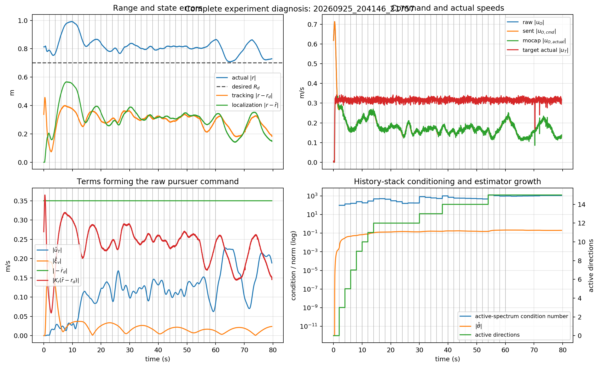

# 实车 bearing-only tracking 发散诊断

## 技术结论

最近三次有完整记录的实验均表明：主要故障位于目标输入辨识器/历史栈，而不是动捕坐标方向或底盘反向执行。最近一次实验在约 2.0 s 加入第 2 个历史窗时，目标速度估计 `||uTHat||` 达到 2.54 m/s，实际目标速度只有约 0.13–0.17 m/s；随后相对位置估计误差从约 0.95 m 增长到 8.34 m，原始 pursuer 指令最高达到 3.05 m/s。

`0.4 m/s` 限幅只把错误控制量截断，并没有制造辨识器发散。取消限幅会把上述 3.05 m/s 原始指令直接交给底盘，因此不能把“去限幅”当作修复方案。

## 完整曲线证明辨识器先发散



灰色竖线表示新的 1 s 历史窗进入辨识器。最近一次实验的关键时刻如下。

| 时刻 | 历史窗/激活方向 | `||uTHat||` | `||r-rHat||` | 原始 `||uO||` | 解释 |
|---:|---:|---:|---:|---:|---|
| 0.02 s | 0 / 0 | 0.000 m/s | 0.812 m | 0.280 m/s | 全部估计从零开始 |
| 1.00 s | 1 / 5 | 0.001 m/s | 0.770 m | 0.417 m/s | 仍基本正常 |
| 2.00 s | 2 / 7 | 2.542 m/s | 0.953 m | 2.721 m/s | 目标速度估计首先出现不可能值 |
| 3.00 s | 3 / 9 | 2.070 m/s | 4.031 m | 1.937 m/s | 错误速度估计已驱动状态观测器发散 |
| 5.00 s | 5 / 10 | 0.796 m/s | 6.580 m | 1.571 m/s | 即使 `uTHat` 暂时下降，`xiHat` 已经发散 |
| 5.70 s | 5 / 10 | 1.005 m/s | 8.340 m | 1.953 m/s | 闭环继续远离 |

历史聚合矩阵的激活谱条件数约为 `1.1e5–3.6e5`；前一次实验一度达到 `4.7e6`。代码使用 `gamma=1e-7` 对所有大于阈值的特征值求倒数：

```text
thetaGamma = Qa * ((Qa' * Zh) ./ lambda_active)
```

因此很小的 `lambda_active` 会把窗口中的速度误差、时序误差和模型误差放大。无噪声 MATLAB 数据严格满足积分回归关系，实车数据不满足，所以相同的 `gamma` 并不具有相同的数值鲁棒性。

为验证这个判断，我保持最近实验记录下来的 `b(t)`、`uO_actual(t)` 和采样间隔不变，只离线重放辨识器/观测器。该测试不改变车辆轨迹，因此是敏感性检查，不是闭环稳定性证明。

| 离线设置 | 最终 `||r-rHat||` | 最大 `||uT_actual-uTHat||` | 最大原始 `||uO||` |
|---|---:|---:|---:|
| `gamma=1e-7`（当前值） | 8.342 m | 3.057 m/s | 3.050 m/s |
| `gamma=3e-7` | 1.029 m | 0.913 m/s | 2.073 m/s |
| `gamma=1e-6` | 0.919 m | 0.817 m/s | 1.348 m/s |
| `gamma=1e-4` | 0.292 m | 0.246 m/s | 0.992 m/s |
| `kh=0`（禁用历史项） | 0.341 m | 0.170 m/s | 0.760 m/s |

仅改变历史栈的截断阈值或关掉历史项，就能在同一批输入数据上将最终定位误差从 8.34 m 降到约 0.3 m。这是“历史栈病态放大”为主要驱动因素的最强证据；但合适阈值仍需闭环仿真和受控实车实验确认。

## 数据质量与坐标系检查

最近一次日志含 285 个控制样本、持续 5.70 s；上一条较长日志含 457 个样本、持续 9.14 s。

| 检查 | 实验结果 | 判断 |
|---|---:|---|
| 控制周期 | 中位数 20.01 ms，最大 21.93 ms | 50 Hz 调度正常 |
| 动捕位姿年龄 | 95% 小于约 16 ms | 无明显丢帧/陈旧数据 |
| 速度拟合接受率 | pursuer 与 target 均为 99.3% | 没有大量差分尖峰被拒绝 |
| target 指令—实速误差 | 中位数 0.018 m/s | 目标底盘执行合理，但并非理想积分器 |
| pursuer 指令—实速时延 | 最佳约 160 ms | MATLAB 的瞬时执行假设不成立 |
| pursuer 方向映射 | 较长实验拟合旋转误差约 1.8°，`R²=0.945` | 不支持 x/y 反向或旋转 180° 的假设 |
| bearing 平滑残差 | 95% 约 0.225°（较长实验） | 方位噪声不大，但病态逆仍可放大它 |

所以证据不支持“VRPN 世界坐标轴方向错误”或“底盘把正方向执行成负方向”。传感器并非理想，但其误差量级远小于 `uTHat` 达到 2–3 m/s 的错误；这是算法对现实误差过度敏感，而不是动捕本身产生了米级跳变。

## 四张基础图与公式的对应关系

先定义世界坐标系变量：

```text
r = pT - pO                         # target 相对 pursuer 的真实向量，仅用动捕作诊断
rho = ||r||                         # 两车实际距离
b = r / ||r||                       # 算法唯一可观测的目标方位
rd = Rd [cos(phi0 + wd*t), sin(phi0 + wd*t)]^T
rdDot = Rd*wd [-sin(phi0 + wd*t), cos(phi0 + wd*t)]^T
rHat = xiHat[0:2]                   # 相对位置估计
```

### 1. World trajectory

- 蓝线：`pT(t)=[xT(t),yT(t)]`，target 的动捕世界轨迹。
- 橙线：`pO(t)=[xO(t),yO(t)]`，pursuer 的动捕世界轨迹。
- 红箭头：算法发送的 pursuer 世界系速度 `uO_cmd`。
- 绿箭头：由 pursuer 动捕位置短窗拟合出的实际世界速度 `uO_actual`。

target 的实际控制律为：

```text
uT = vd*d + ve*b + vj*J*b
```

其中 `ve*b` 沿视线远离 pursuer，`vj*J*b` 是切向运动，`J=[[0,-1],[1,0]]`。

### 2. MATLAB estimation and tracking errors

```text
目标输入估计误差: eU     = ||uT_actual - uTHat||       [m/s]
相对定位误差:     ePos   = ||r - rHat||                [m]
轨迹跟踪误差:     eTrack = ||r - rd||                  [m]
```

注意 `eTrack` 不等于 `|rho-Rd|`。前者同时包含距离误差和相对方位/相位误差；即使两车距离接近 `Rd`，方向不对时 `eTrack` 仍可能很大。另外，这张图为了对应 MATLAB 把 m 和 m/s 画在同一坐标轴，不能直接比较三条线的物理量大小。

### 3. MATLAB target and pursuer speeds

```text
target 实速:       ||uT_actual|| = sqrt(vTx^2 + vTy^2)
pursuer 实速:      ||uO_actual|| = sqrt(vOx^2 + vOy^2)
pursuer 下发速度:  ||uO_cmd||    = sqrt(uOcmd_x^2 + uOcmd_y^2)
```

前两条来自动捕位置拟合，第三条是控制指令。原来的 0.4 m/s 水平直线是限幅后的命令，不是实际速度，也不是算法原始输出。

### 4. Actual and desired relative range

```text
实际距离: rho = ||r|| = sqrt((xT-xO)^2 + (yT-yO)^2)
期望距离: ||rd|| = Rd = 0.50 m
```

这张图只比较距离，不检查期望圆周的相位，所以它与 `eTrack=||r-rd||` 的趋势可以不同。

## pursuer 原始控制量为何不断增大

论文/MATLAB 式 (63) 在程序中为：

```text
uO_raw = uTHat + xiHat_v - rdDot + Kr*(rHat-rd),   Kr=0.25*I
```

最近一次实验的分解显示：

- `||-rdDot|| = Rd*wd = 0.25 m/s`，始终有界，不是问题源；
- `||uTHat||` 最先异常，在 2.0 s 达到 2.54 m/s，峰值 3.01 m/s；
- 随后 `||xiHat_v||` 增长到 1.70 m/s；
- `||Kr*(rHat-rd)||` 增长到 1.51 m/s；
- 这些向量相加后产生最高 3.05 m/s 的原始控制指令。

因此“pursuer 越跑越快”的因果链是：病态历史栈产生错误 `uTHat` → 相对状态观测器 `xiHat` 被错误输入驱动 → 位置反馈项继续增长 → 原始控制速度增长。它不是固定的 `-rdDot` 圆周项导致的。

## 限幅修改和仍保留的数值保护

当前默认 `--max-speed 0`，表示 target、pursuer 核心输出和发布前检查均不做速度模长限幅；传入正数可以恢复限幅。

动捕速度的 `0.8 m/s` 有效性上限也已默认关闭，因为 pursuer 取消指令限幅后，真实速度可能超过 0.8 m/s；若仍保留旧门限，算法会错误地继续使用上一次低速估计。需要恢复时可传 `--mocap-max-valid-speed 0.8`。

没有删除以下操作，因为它们不是速度限幅：

- 0.06 s 动捕位置回归和 0.02 s 一阶低通：这是实际速度估计方法；
- RK4 使用的异常控制间隔限制在两个名义周期内：防止 ROS 卡顿造成一次巨大积分跳变；
- `Po` 的最小特征值投影：防止 Riccati 数值积分失去正定性；
- 位姿过期或两车重合时发送零速：输入数据无效时的基本保护。

删除这些数值有效性检查不会让程序更接近论文的连续理想模型，反而会把网络/传感器异常直接注入辨识器。如果需要严格逐项 A/B 测试，应分别做成命令行开关，而不应一次全部删除。

## 建议的下一步

1. 先不要用无速度限制的版本直接启动实车；同一实验已经证明原始请求可达 3.05 m/s。
2. 在记录数据离线回放中优先测试历史栈：扫描 `gamma=3e-7` 到 `1e-4`、增加条件数/回归残差门控，或暂时令 `kh=0`。最新回放中 `gamma=1e-4` 和 `kh=0` 都明显抑制发散，而只平滑 `uO_actual` 的旧测试没有解决问题。
3. 给 `b(t)` 和短窗速度 `uO_actual` 做时间对齐。当前速度代表过去约 50 ms 窗口，底盘还存在约 160 ms 动态滞后，而回归式按同一时刻处理。
4. 每次只改一个辨识参数，并用相同 CSV 回放比较 `||uTHat||`、历史谱条件数、`||r-rHat||` 和原始 `||uO||`；通过后再做低速实车实验。

## 范围与限制

结论基于 2026-09-09 的三条完整实车日志，重点实验为 `20260909_194146_82099`。这些数据足以排除明显坐标反向和定位跳变，并定位辨识器的异常先后顺序；但它们不能单独证明某一个具体时延或噪声项是唯一原因。要确定最佳 `gamma` 或同步补偿量，需要在相同记录上做闭环/回放参数扫描，然后用新的受控实车实验验证。

完整性复核结果：日志时间严格递增、无重复行；位置差得到的 `r`、`rho`、`b`，三个误差定义以及四个控制分量之和均与 CSV 已记录值逐样本一致（最大数值差为浮点零或 `5.6e-17` 量级）。因此本报告可用于定位问题，但所有无速度限制的实车结论仍应按上述风险说明解释。
